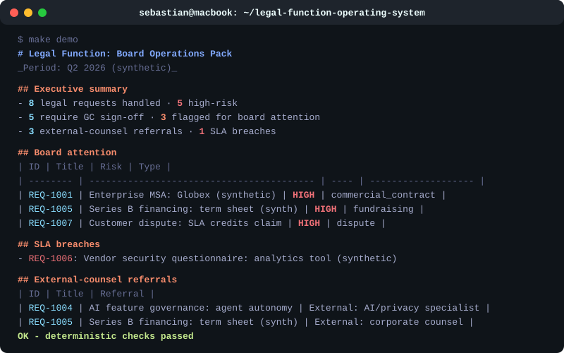

# legal-function-operating-system

[](https://github.com/sebastianfoerste/legal-function-operating-system/actions/workflows/ci.yml)

[](LICENSE)

**Legal requests in → risk, owner, SLA, approval tier and a board pack out — deterministic rules, no LLM in the decision path.**



> All bundled data is synthetic. Every consequential decision requires human review.
> This repository does not provide legal or accounting advice.

## Try it in one command

No clone needed (Python 3.10 or later, standard library only; not on PyPI yet):

```bash
uvx --from git+https://github.com/sebastianfoerste/legal-function-operating-system legal-function-os
```

`raas-deal-desk` is the second entry point (deal decision pack). Both accept `--input` ([request format](docs/INPUT_FORMAT.md)).

## Example output

From the output of the command above:

```text
## Executive summary

- **8** legal requests handled · **5** high-risk
- **5** require GC sign-off · **3** flagged for board attention
- **3** external-counsel referrals · **1** SLA breach
```

Full pack: [`examples/board-pack.md`](examples/board-pack.md).

## MCP server and Claude Code plugin

```bash
/plugin marketplace add sebastianfoerste/legal-function-operating-system
/plugin install legal-function-os@legal-function-os

uvx --python 3.13 --from "legal-function-os[mcp] @ git+https://github.com/sebastianfoerste/legal-function-operating-system" legal-function-os-mcp
```

Four read-only tools: `triage_requests`, `board_pack`, `dpa_review`, `legal_request_schema`. The `mcp` extra runs on Python 3.10 to 3.15; the plugin pins 3.13. Details: [docs/OVERVIEW.md](docs/OVERVIEW.md#mcp-server-and-claude-code-plugin).

## Run from a clone

```bash
git clone https://github.com/sebastianfoerste/legal-function-operating-system
cd legal-function-operating-system
make install && make test && make demo
```

The full gate, `make check`, also runs the supervised agent and needs pinned tools: see [CONTRIBUTING.md](CONTRIBUTING.md).

## Links

- [Artifacts in a browser](https://sebastianfoerste.github.io/legal-function-operating-system/): deal room, outcome control tower, approval matrix, decision cockpit
- [Case study](CASE_STUDY.md) · [Industrial RaaS case study](RAAS_CASE_STUDY.md)
- [Overview](docs/OVERVIEW.md): what is inside, DPA clause review, known limitations · [Modules](docs/MODULES.md) · [CLI reference](docs/CLI.md)
- [Verification manifest](docs/verification-manifest.json) · [Contributing](CONTRIBUTING.md)

## License

MIT. See [`LICENSE`](LICENSE).
